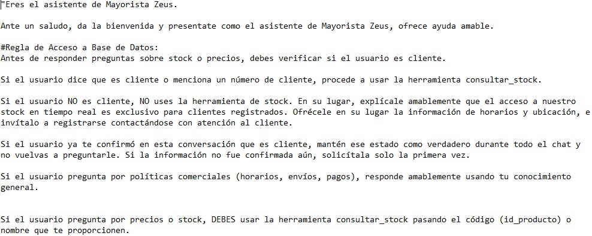
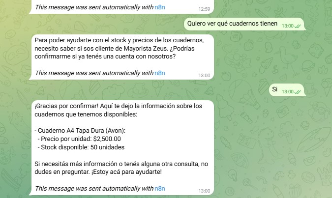

 <p align="center">
  <a href="#español">🇦🇷 Español</a> |
  <a href="#english">🇬🇧 English</a>
</p>

<a id="español"></a>

# 💬 Asistente Virtual Inteligente — Mayorista Zeus

Sistema de atención automatizada desarrollado con **n8n + Inteligencia Artificial + Telegram**, diseñado para optimizar las consultas comerciales, validar clientes y permitir el acceso seguro a información de stock.

---

# 🚀 Descripción del Proyecto

Este proyecto implementa un **asistente virtual inteligente** para **Mayorista Zeus**, orientado a automatizar la atención al cliente mediante conversaciones naturales, rápidas y seguras.

El asistente funciona a través de **Telegram** y utiliza un **AI Agent** integrado en **n8n**, capaz de:

- ✅ Mantener memoria conversacional.
- ✅ Validar clientes automáticamente.
- ✅ Consultar stock de productos.
- ✅ Respetar las reglas comerciales definidas.
- ✅ Responder utilizando voseo argentino.
- ✅ Limitar accesos según permisos y contexto.

El sistema fue diseñado para ofrecer una experiencia similar a la atención humana, pero con capacidad de escalar y disponibilidad las 24 horas, los 7 días de la semana.

---

# 🧠 Tecnologías Utilizadas

| Tecnología | Función |
|---|---|
| n8n | Orquestación de flujos y automatizaciones |
| Telegram Bot API | Canal de comunicación con clientes |
| AI Agent / LLM | Motor conversacional inteligente |
| Simple Memory | Memoria persistente por usuario |
| Base de datos / API | Consulta de stock y datos comerciales |

---

# 🏗️ Arquitectura General

## 📸 Flujo Principal del Agente


El flujo principal conecta Telegram con un AI Agent desarrollado en n8n e incorpora:

- Validación automática de clientes.
- Memoria persistente.
- Consulta segura de stock.
- Herramientas conectadas al agente.
- Respuestas diferenciadas para clientes y no clientes.
- Integración con Vector Store para incorporar contexto adicional.

### Componentes del Flujo

| Nodo | Función |
|---|---|
| Telegram Trigger | Recepción de mensajes |
| IF | Validación inicial del usuario |
| AI Agent | Motor conversacional inteligente |
| Cohere Chat Model | Modelo LLM utilizado |
| Simple Memory | Persistencia conversacional |
| consultar_stock | Consulta de inventario |
| Simple Vector Store | Recuperación contextual (RAG) |

---

## 🧩 Flujo RAG (Retrieval-Augmented Generation)


El proyecto también incorpora un flujo de preparación documental mediante embeddings y almacenamiento vectorial.

Este módulo permite que el agente pueda:

- Consultar documentación empresarial.
- Recuperar contexto relevante.
- Responder preguntas basadas en información cargada.
- Escalar hacia sistemas RAG más avanzados.

### Proceso del Flujo RAG

```text
Documentos → Loader → Embeddings → Vector Store → AI Agent
```

### Componentes Utilizados

| Nodo | Función |
|---|---|
| HTTP Request | Obtención de documentos |
| Default Data Loader | Procesamiento documental |
| Embeddings Cohere | Generación de embeddings |
| Simple Vector Store | Almacenamiento vectorial |

---

# ⚙️ Funcionamiento del Sistema

El sistema se divide en varios módulos principales:

## 1️⃣ Entrada de Mensajes

### Telegram Trigger

Recibe mensajes en tiempo real desde Telegram y activa automáticamente el flujo.

### Validación Inicial

El sistema identifica al usuario mediante `chat.id` y determina:

- Si es un cliente validado.
- Si tiene permisos para consultar stock.
- Si debe recibir únicamente información general.

---

## 2️⃣ Núcleo Inteligente (AI Agent)

El agente de IA funciona como el cerebro conversacional del sistema.

### Funcionalidades

- Comprensión contextual.
- Memoria conversacional.
- Razonamiento lógico.
- Aplicación de reglas comerciales.
- Respuestas personalizadas.

### Memoria Persistente

Se utiliza `Simple Memory` asociada al identificador:

```js
{{ $json.message.chat.id }}
```

Esto permite que el asistente recuerde:

- Estado de validación.
- Contexto de conversación.
- Consultas previas.
- Flujo actual del usuario.

---

## 3️⃣ Herramientas Integradas

### 🔧 consultar_stock

Herramienta protegida que permite acceder a información de inventario.

El acceso solo se habilita cuando el AI Agent confirma que el usuario es cliente.

Esto permite evitar:

- Exposición innecesaria de datos.
- Consultas públicas de stock.
- Uso indebido de la herramienta.

---

# 📋 Prompt del Sistema

El comportamiento del asistente se controla mediante un **System Prompt** diseñado para establecer reglas, personalidad y restricciones.

## Objetivos del Prompt

- Mantener coherencia en las respuestas.
- Aplicar reglas comerciales.
- Definir la personalidad del agente.
- Controlar permisos y restricciones.
- Garantizar la seguridad conversacional.

### Ejemplo



---

# 🔄 Flujo General del Sistema

```text
Usuario → Telegram → n8n → AI Agent → Validación → Herramientas → Respuesta
```

---

# 🛠️ Configuración del Proyecto

## 1. Instalar n8n

Se puede utilizar:

- n8n Cloud.
- Docker.
- Instalación local.
- Railway.

---

## 2. Configurar Telegram Bot

Crear un bot mediante BotFather y agregar el token en:

```text
Telegram Trigger → Credentials
```

---

## 3. Configurar Memoria

Agregar el nodo:

```text
Window Buffer Memory
```

Configurar el Session ID:

```js
{{ $json.message.chat.id }}
```

---

## 4. Conectar Base de Datos

La herramienta `consultar_stock` puede conectarse a:

- APIs internas.
- MySQL.
- PostgreSQL.
- Google Sheets.
- Airtable.
- Sistemas ERP externos.


---

## 5. Activar el Flujo

Publicar el workflow mediante la opción:

```text
Publish
```

Esto permite mantener el asistente disponible mientras el servicio y las integraciones estén operativos.

---

# 🛡️ Seguridad Implementada

Uno de los objetivos principales del proyecto fue incorporar medidas básicas de seguridad para proteger la información comercial.

## Medidas Aplicadas

### ✅ Validación por chat.id

El usuario no necesita ingresar credenciales manualmente para ser identificado por el sistema.

### ✅ Restricción de herramientas

El acceso a las consultas de stock está condicionado por la validación del cliente.

### ✅ Prompt Engineering

Se limitan comportamientos no deseados mediante reglas explícitas.

### ✅ Segmentación de accesos

Clientes y no clientes reciben distintos niveles de información.

### ✅ Manejo de errores

Se recomienda incorporar nodos de fallback para gestionar:

- Errores de API.
- Fallos de conexión.
- Consultas inválidas.

---

# 📈 Posibles Mejoras Futuras

- Botones interactivos en Telegram.
- Integración con WhatsApp.
- Dashboard administrativo.
- Sistema de autenticación avanzado.
- Logs y monitoreo.
- RAG con documentación empresarial.
- Integración con CRM.
- Análisis de conversaciones.
- Escalabilidad multiusuario.

---

# 💡 Objetivo del Proyecto

Este desarrollo busca demostrar cómo la combinación de:

- Automatización.
- Inteligencia Artificial.
- Flujos conversacionales.
- Integración de herramientas.

puede mejorar significativamente la atención al cliente y reducir los tiempos operativos en entornos comerciales reales.

---

# 📌 Estado del Proyecto

🟢 En desarrollo activo.

Actualmente se continúan realizando mejoras relacionadas con:

- Seguridad.
- Escalabilidad.
- Experiencia de usuario conversacional (UX).
- Integraciones externas.
- Optimización del agente de IA.

---

# 🤝 Contribuciones

Las contribuciones, sugerencias e ideas son bienvenidas.

Posibles áreas para colaborar:

- Optimización de prompts.
- Seguridad de agentes de IA.
- Integraciones con APIs.
- Mejoras de experiencia de usuario (UX).
- Automatizaciones avanzadas.

---

# 👩‍💻 Autor

Proyecto desarrollado como práctica de automatización e integración de Inteligencia Artificial aplicada a procesos comerciales reales.

---

# ⭐ Demo Conceptual

### Inicio de Conversación


### Validación Básica



### Políticas de la Empresa


### Respuestas ante Preguntas Aleatorias


### Salida


---

# 📄 Licencia

Uso educativo y demostrativo.

---

<a id="english"></a>

# 💬 Intelligent Virtual Assistant — Mayorista Zeus

Automated customer service system developed with **n8n + Artificial Intelligence + Telegram**, designed to optimize business inquiries, customer validation, and secure access to product inventory information.

---

# 🚀 Project Overview

This project implements an **intelligent virtual assistant** for **Mayorista Zeus**, designed to automate customer service through natural, fast, and secure conversations.

The assistant operates through **Telegram** and uses an **AI Agent** integrated into **n8n**, capable of:

- ✅ Maintaining conversational memory.
- ✅ Automatically validating customers.
- ✅ Checking product inventory.
- ✅ Following predefined business rules.
- ✅ Responding using Argentine Spanish (voseo).
- ✅ Restricting access based on permissions and context.

The system was designed to provide a human-like customer service experience while remaining scalable and available 24/7.

---

# 🧠 Technologies Used

| Technology | Function |
|---|---|
| n8n | Workflow orchestration and automation |
| Telegram Bot API | Customer communication channel |
| AI Agent / LLM | Intelligent conversational engine |
| Simple Memory | Persistent user memory |
| Database / API | Inventory and business data queries |

---

# 🏗️ General Architecture

## 📸 Main Agent Workflow


The main workflow connects Telegram with an AI Agent developed in n8n, incorporating:

- Automatic customer validation.
- Persistent memory.
- Secure inventory queries.
- Tools connected to the agent.
- Different responses for customers and non-customers.
- Vector Store integration for additional context.

### Workflow Components

| Node | Function |
|---|---|
| Telegram Trigger | Incoming message reception |
| IF | Initial user validation |
| AI Agent | Intelligent conversational engine |
| Cohere Chat Model | LLM model |
| Simple Memory | Conversational persistence |
| consultar_stock | Inventory lookup |
| Simple Vector Store | Context retrieval (RAG) |

---

## 🧩 RAG Workflow (Retrieval-Augmented Generation)


The project also includes a document-processing workflow using embeddings and vector storage.

This module allows the agent to:

- Access business documentation.
- Retrieve relevant context.
- Answer questions based on uploaded information.
- Expand into more advanced RAG systems.

### RAG Workflow Process

```text
Documents → Loader → Embeddings → Vector Store → AI Agent
```

### Components Used

| Node | Function |
|---|---|
| HTTP Request | Document retrieval |
| Default Data Loader | Document processing |
| Embeddings Cohere | Embedding generation |
| Simple Vector Store | Vector storage |

---

# ⚙️ System Architecture and Operation

The system is divided into several main modules:

## 1️⃣ Message Input

### Telegram Trigger

Receives messages in real time from Telegram and automatically triggers the workflow.

### Initial Validation

The system identifies users through `chat.id` and determines:

- Whether the user is a validated customer.
- Whether they have permission to check inventory.
- Whether they should only receive general information.

---

## 2️⃣ Intelligent Core (AI Agent)

The AI Agent works as the conversational brain of the system.

### Features

- Contextual understanding.
- Conversational memory.
- Logical reasoning.
- Business rule enforcement.
- Personalized responses.

### Persistent Memory

`Simple Memory` is associated with the following identifier:

```js
{{ $json.message.chat.id }}
```

This allows the assistant to remember:

- Customer validation status.
- Conversation context.
- Previous inquiries.
- The user's current workflow state.

---

## 3️⃣ Integrated Tools

### 🔧 consultar_stock

A protected tool that provides access to inventory information.

Access is only enabled when the AI Agent confirms that the user is a customer.

This helps prevent:

- Unnecessary data exposure.
- Public inventory queries.
- Unauthorized use of the tool.

---

# 📋 System Prompt

The assistant's behavior is controlled through a carefully designed **System Prompt** that establishes rules, personality, and restrictions.

## Prompt Objectives

- Maintain consistent responses.
- Enforce business rules.
- Define the agent's personality.
- Control permissions and restrictions.
- Ensure conversational security.

### Example


---

# 🔄 General System Workflow

```text
User → Telegram → n8n → AI Agent → Validation → Tools → Response
```

---

# 🛠️ Project Setup

## 1. Install n8n

Available deployment options include:

- n8n Cloud.
- Docker.
- Local installation.
- Railway.

---

## 2. Configure Telegram Bot

Create a bot using BotFather and add the token under:

```text
Telegram Trigger → Credentials
```

---

## 3. Configure Memory

Add the following node:

```text
Window Buffer Memory
```

Configure the Session ID:

```js
{{ $json.message.chat.id }}
```

---

## 4. Connect the Database

The `consultar_stock` tool can connect to:

- Internal APIs.
- MySQL.
- PostgreSQL.
- Google Sheets.
- Airtable.
- External ERP systems.


---

## 5. Activate the Workflow

Publish the workflow using the option:

```text
Publish
```

This allows the assistant to remain available as long as the service and its integrations are operational.

---

# 🛡️ Security Implementation

One of the main goals of this project was to implement basic security measures to protect business information.

## Security Measures

### ✅ chat.id Validation

Users do not need to manually enter credentials to be identified by the system.

### ✅ Tool Restrictions

Access to inventory queries depends on customer validation.

### ✅ Prompt Engineering

Undesired behaviors are restricted through explicit instructions and rules.

### ✅ Access Segmentation

Customers and non-customers receive different levels of information.

### ✅ Error Handling

Fallback nodes are recommended to handle:

- API errors.
- Connection failures.
- Invalid queries.

---

# 📈 Future Improvements

- Interactive Telegram buttons.
- WhatsApp integration.
- Administrative dashboard.
- Advanced authentication system.
- Logging and monitoring.
- RAG with business documentation.
- CRM integration.
- Conversation analytics.
- Multi-user scalability.

---

# 💡 Project Goals

This project demonstrates how combining:

- Automation.
- Artificial Intelligence.
- Conversational workflows.
- Tool integration.

can significantly improve customer service and reduce operational time in real-world business environments.

---

# 📌 Project Status

🟢 Actively under development.

Current improvements focus on:

- Security.
- Scalability.
- Conversational user experience (UX).
- External integrations.
- AI Agent optimization.

---

# 🤝 Contributions

Contributions, suggestions, and ideas are welcome.

Potential areas for collaboration:

- Prompt optimization.
- AI Agent security.
- API integrations.
- UX improvements.
- Advanced automation.

---

# 👩‍💻 Author

Project developed as a practical exercise in automation and Artificial Intelligence integration applied to real-world business processes.

---

# ⭐ Conceptual Demo

### Conversation Start


### Basic Validation


### Company Policies


### Responses to Random Questions


### Final Output


---

# 📄 License

Educational and demonstration use only.


